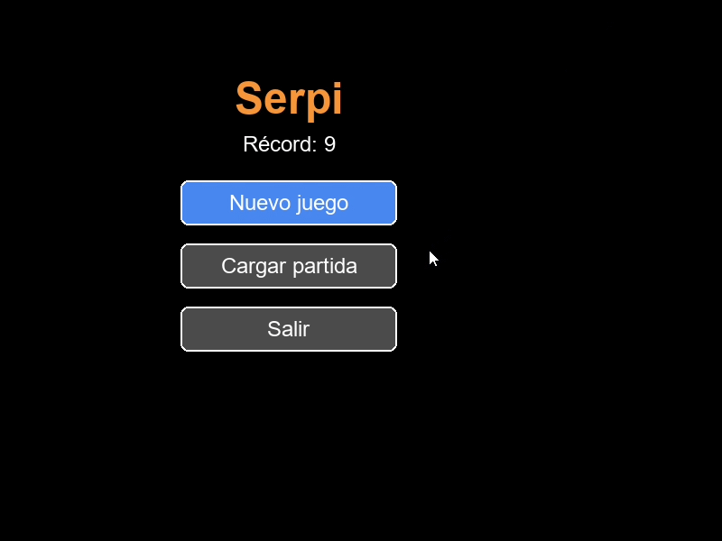

# Juego Serpi

Juego clásico Snake desarrollado en Python con Pygame (pygame-ce). Incluye menú inicial, niveles, guardado automático de partida y persistencia de récords en JSON.



## Características

- Menú inicial con botones: Nuevo juego, Cargar partida y Salir.
- Movimiento con flechas o WASD.
- Crecimiento al comer y colisiones con bordes y con el propio cuerpo.
- Sistema de niveles: cada 5 puntos sube de nivel.
- Guardado automático de la partida al subir de nivel.
- Botón "Cargar partida" que se habilita solo si existe una partida guardada.
- Puntaje, nivel y récord en pantalla.
- Reinicio rápido con R y vuelta al menú con M tras un Game Over.
- Código orientado a objetos separado por responsabilidades (`Snake`, `Food`, persistencia y bucle principal).

## Requisitos

- Python 3.10 o superior.
- `pygame-ce` (Community Edition), compatible con versiones recientes de Python. Se importa igual que `pygame`.

## Instalación y ejecución

```bash
git clone https://github.com/TU-USUARIO/snake-pygame.git
cd snake-pygame
python -m venv .venv
.venv\Scripts\activate      # Windows
# source .venv/bin/activate  # Linux / macOS
pip install -r requirements.txt
python main.py